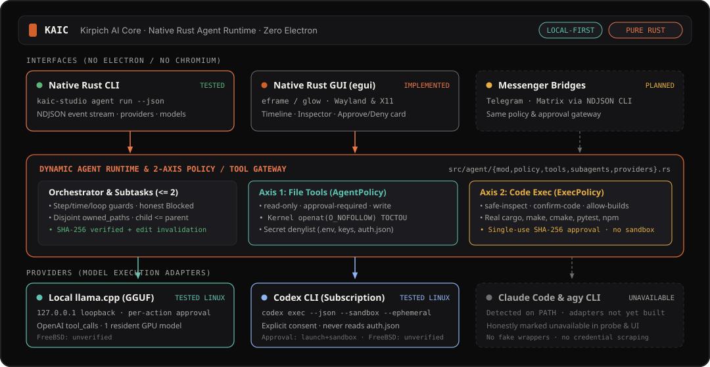

<p align="center">
  <picture>
    <source media="(prefers-color-scheme: dark)" srcset="Desige/kaic-wordmark-on-dark.svg">
    
  </picture>
</p>

<h3 align="center">100% Native Rust AI Agent Environment — Terminal UI, CLI (NDJSON), and Native GUI.</h3>

<p align="center">
  <a href="LICENSE"></a>
  
  
  
  
  
</p>

**KAIC (Kirpich AI Core)** is a local-first AI agent runtime and coding workbench written cleanly in **Rust** (with targeted `x86_64` inline Assembly acceleration and portable Rust fallbacks). Zero Electron, zero Node.js, zero Chromium, zero telemetry.

Instead of emitting static one-shot plans, KAIC iterates inside your workspace — inspecting files, applying unified patches (`apply_patch`), executing real project builds and tests, repairing malformed local-model tool calls, compacting context when budgets fill, and coordinating bounded subtasks — while keeping **files, execution policies, approvals, and external transmission under your control**.

<p align="center">
  
</p>

> **Pure Rust Migration Complete.** Electron, React, TypeScript, JavaScript, Node.js, and WebView wrappers have been eliminated from the active repository. Use `kaic-studio tui` for an interactive Claude Code-inspired terminal UI (and automatic headless TTY fallback), `kaic-studio agent run --json` for CLI/automation/messenger bridges, and optional `kaic-studio gui` (`eframe/egui`) on desktop.

**Target OS scope: Linux and FreeBSD.** Verified on **Linux x86_64** (POSIX terminal, kernel `openat(O_NOFOLLOW)`, `prctl`, `/proc/net/tcp`). **FreeBSD** adapters (`procctl`, `sockstat`, POSIX `termios`) are implemented in [`Studio/src/platform.rs`](Studio/src/platform.rs) but **not yet runtime-tested** on a live FreeBSD host.

---

## Native Terminal UI (`kaic-studio tui`)

Built natively on POSIX `termios` + `libc::poll` + `SIGWINCH` with zero external TUI dependencies (`TrueColor`, `ANSI-16`, and `NO_COLOR`/`--no-color` plain mode):

- **Minimalist workspace layout**: compact Kich welcome banner, single-line header (`provider`, `origin`, `model`, `ctx%`, policies, `[DYN:OFF]`), scrollable transcript, multiline composer (`Ctrl+J` / `Shift+Enter` / `Alt+Enter` + bracketed paste).
- **Real-time workflow UX**: live streaming text deltas, native syntax highlighting in code blocks (`rust`, `python`, `c`/`cpp`, `sh`, `json`, `asm`), collapsible tool execution cards (`Ctrl+O` / `Ctrl+T` / `/toggle`), inline colorized unified diffs, and subtask status.
- **Reliability & safety**: slash-command autocomplete (`Tab` / `Up` / `Down`), persistent command history (`tui-history.json`) and shared GUI/TUI sessions (`state.json`), modal HITL approval bar (`[y]` approve once / `[n]` deny / `[Esc]` cancel; bare `Enter` never approves), ANSI escape stripping on untrusted outputs, and instant `Esc` cancellation.

---

## Unified Provider Architecture (`[KAIC native]` vs `[External CLI]`)

KAIC clearly separates providers driven by **KAIC's native tool/policy/approval loop** from **externally managed authenticated CLI sessions**:

| Provider | Execution Origin | Protocol / Transport | Status (CPU-verified) |
|---|---|---|---|
| `local` (`LocalLlama`) | `KAIC native` agent loop | Managed loopback `llama-server` + SSE + Jinja/fallback tool parser + optional GBNF grammar | Build & mock HTTP tested; live GPU run pending free VRAM |
| `ollama` (`OllamaLocal`) | `KAIC native` agent loop | Loopback `/api/chat` NDJSON + `/api/tags` (never routes to cloud) | Build & mock loopback HTTP tested |
| `openai` (`OpenAiCompat`) | `KAIC native` agent loop | OpenAI `/v1/chat/completions` SSE (loopback HTTP allowed; remote requires HTTPS + explicit consent) | Build & mock loopback HTTP tested |
| `anthropic` (`AnthropicApi`) | `KAIC native` agent loop | Anthropic `/v1/messages` SSE (`tool_use` + byte-safe UTF-8 streaming; requires API key env + consent) | Build & mock loopback HTTP tested |
| `codex` (`CodexCli`) | `External CLI` | Official `codex exec --json --sandbox ... --ephemeral` (no credential scraping) | Build & live read-only tested; mock-tested |
| `claude` (`ClaudeCli`) | `External CLI` | Official `claude -p --output-format stream-json --permission-mode <plan\|acceptEdits>` (`--restricted` in read-only) | Build & mock CLI script tested |
| `agy` (`AgyCli`) | `External CLI` | Official `agy --print --output-format stream-json --sandbox --mode <plan\|accept-edits>` | Build & mock CLI script tested |

API keys (`OPENAI_API_KEY`, `ANTHROPIC_API_KEY`) are read only from environment variables in memory (`Secret`) and **never persisted** to `state.json`.

---

## Quick Start (Linux x86_64)

```bash
# Build and run CPU test suites across all active Rust crates
cargo build --manifest-path Studio/Cargo.toml --locked
cargo test --manifest-path Studio/Cargo.toml --locked
cargo test --manifest-path kaic-project/kaic-backend/Cargo.toml --locked
cargo test --manifest-path kaic-project/kaic-tui/Cargo.toml --locked

# Launch Native Terminal UI (also automatic when DISPLAY and WAYLAND_DISPLAY are unset)
./Studio/target/debug/kaic-studio tui --workspace /abs/path/to/project

# Run headless NDJSON agent turn
./Studio/target/debug/kaic-studio agent run \
  --workspace /abs/path/to/project \
  --provider ollama \
  --model qwen2.5-coder:14b \
  --policy workspace-write \
  --exec-policy confirm-user-code \
  --task "Fix failing unit test via apply_patch and verify with run_check" \
  --json

# Launch optional native Rust GUI (eframe/egui)
./Studio/target/debug/kaic-studio gui
```

---

## Security & Control Guarantees

1. **Separated File Policy & Code Execution Policy**: file operations use step-by-step kernel `openat(O_DIRECTORY | O_NOFOLLOW)` + `renameat`; `run_check` supports real builds (`cargo`, `make`, `pytest`, `npm`) under independent `ExecPolicy` and is honestly marked `NoneUserPrivileges` (not disguised as an OS sandbox).
2. **Dynamic Interaction Disabled By Default**: multi-agent `SeatManager` (`<= 4` seats), `AtomicSeatGate` (`x86_64` `lock cmpxchg`/`xchg` + portable fallback), and live editing default to **OFF** (`[DYN:OFF]`). See [`kaic-project/docs/dynamic-interaction-architecture.md`](kaic-project/docs/dynamic-interaction-architecture.md) for current internals and planned OS/TTY (`Wayland`, `X11`, `uinput`, `FreeBSD`, `tmux -CC`) adapters.
3. **Single-Use SHA-256 Approvals & Version-Bound Subtasks**: approvals bind `(request_id, SHA-256(task_id || tool || args))`; subtask verification invalidates automatically (`invalidated_after_edit`) on any subsequent file edit.

---

## License

Licensed under **GNU General Public License v3.0 (`GPL-3.0-only`)**. See [`LICENSE`](LICENSE) and [`Studio/THIRD_PARTY_NOTICES`](Studio/THIRD_PARTY_NOTICES).

**Author**: Kirpich Space Company — native Rust engineering tools alongside [EmbedIDE](https://github.com/Kirpich-Space/EmbedIDE).
